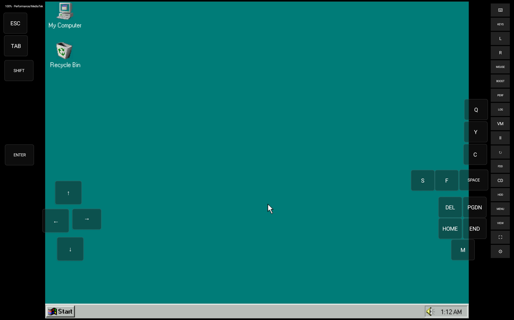
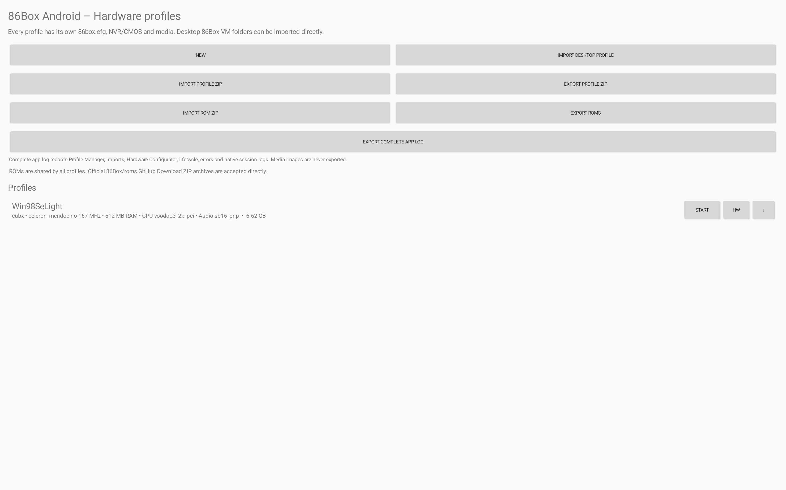
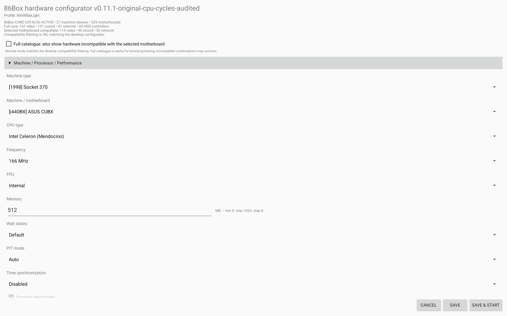
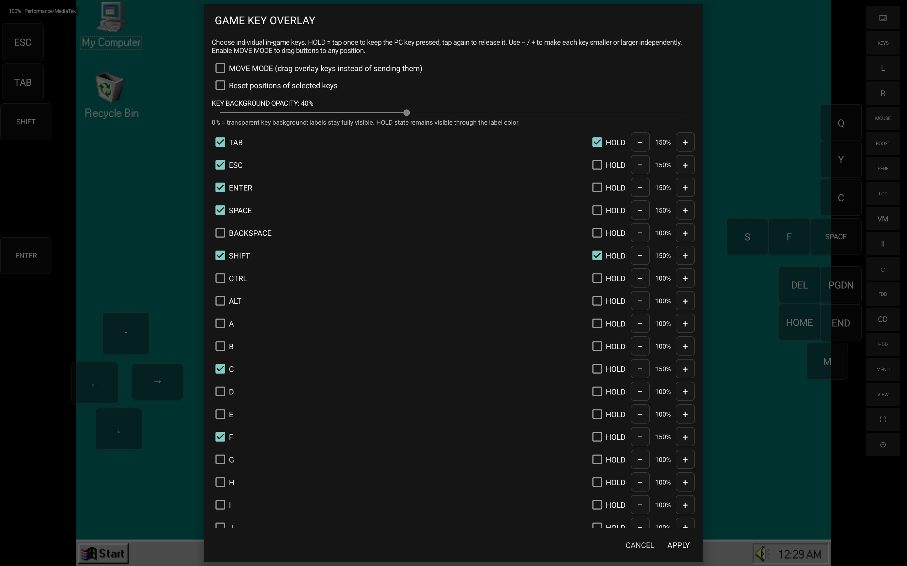

# 86Box Android Final

An independent Android port of [86Box](https://github.com/86Box/86Box), packaged here as the **v0.11.1 Preview**. This repository contains all application and emulator source files from the prepared v0.11.1 package, including the Android app, native core, build scripts, tests, and bundled third-party source. Six GitHub Actions workflow definitions from the ZIP are omitted. The original upstream README is preserved as [README_UPSTREAM.md](README_UPSTREAM.md).

## Main Features

- **Native Android application** – Run 86Box directly on Android devices.
- **Universal APK** – One installation package for multiple supported Android CPU architectures.
- **Physical mouse support** – Designed for proper mouse interaction with emulated PCs.
- **Physical keyboard support** – Use external USB or Bluetooth keyboards.
- **Customizable Game-Key Overlay** – Add, remove, and configure on-screen keys for DOS and classic PC games.
- **Adjustable on-screen controls** – Customize the size and appearance of virtual controls.
- **Classic PC emulation** – Experience vintage PC hardware and compatible operating systems.
- **PC configuration options** – Configure your emulated PC environment.
- **Ongoing improvements** – Continued work on Android compatibility, performance, input handling, and usability.

### Performance varies by device

Emulation performance varies with the Android device's single-core CPU performance. In the project maintainer's experience, an emulated CPU setting of **66 MHz** was needed for good performance on a **OnePlus 15**. On a **Samsung Galaxy Tab S11 Ultra** with a **MediaTek processor**, **166 MHz** ran well. These are example settings; results also depend on the emulated PC and workload.

### Why I Created This Project

I wanted to use 86Box on Android without being limited to a desktop PC.

One of my biggest priorities was making physical mouse and keyboard input practical, while also providing customizable touch controls for mobile gaming.

The project has required a lot of experimentation, especially with Android-specific input handling, display behavior, and performance.

## Screenshots

<table>
  <tr>
    <td><a href="docs/screenshots/01-win98-desktop.jpg"></a><br>Emulated desktop and touch controls</td>
    <td><a href="docs/screenshots/02-hardware-profiles.jpg"></a><br>Hardware profiles</td>
  </tr>
  <tr>
    <td><a href="docs/screenshots/03-hardware-configurator.jpg"></a><br>Hardware configurator</td>
    <td><a href="docs/screenshots/12-game-key-overlay.jpg"></a><br>Customizable game controls</td>
  </tr>
</table>

[View all 13 screenshots](SCREENSHOTS.md). The screenshots were captured on a **Samsung Galaxy Tab S11 Ultra**. Guest operating systems and games shown are examples; they are not included with the app.

## Download and install

Download the [universal Android APK](https://github.com/xxl2005/86Box-Android-Final/releases/download/v0.11.1-preview/86Box-Android-v0.11.1-Final.apk) from the [v0.11.1 Preview release](https://github.com/xxl2005/86Box-Android-Final/releases/tag/v0.11.1-preview). It contains native libraries for **arm64-v8a** and **x86_64**, and requires **Android 9 (API 28) or newer**.

This is a **debug-signed preview APK**, not a production-signed build. The APK signature was verified, but installation and emulator operation on a physical Android device have not been independently verified for this publication. Its SHA-256 checksum is:

```text
5bcf6bcf2d116b32475de7454cb10f32b0fbb3d1827bbf1fa4866dca2bab2a0a
```

## What this version changes

- Uses the original 86Box CPU and dynarec implementations from the project's reviewed v0.9.36 base, with the later experimental CPU worker and thread assist stages removed.
- Offers **Original**, **Fixed**, **Auto**, **Max**, and **Custom** CPU cycle budget modes in the Android interface. **Original 86Box** is the default; these modes do not add another virtual CPU.
- Includes Android touch and physical mouse/keyboard input, VM profiles and hardware configuration, media import, diagnostics, and an on-screen keyboard.
- Carries the v0.11.1 source audit fixes and Android versionCode **83** (`0.11.1-original-cpu-cycles-audited`). See [v0.11.1 audit notes](ANDROID_V0.11.1_CPU_CYCLES_AUDIT_FIX_DE.md) and [CPU cycle behavior](ANDROID_V0.11.0_ORIGINAL_CPU_CYCLES_DE.md).

## ROMs

**ROM/BIOS files are not included** in this repository or the APK. Supply only files you are permitted to use. See the separate [ROM notice](ROM_NOTICE.md) for the source build location and the in-app ROM ZIP import path.

## Build from source

The Android project is in [`android/`](android/). On a Windows machine with the Android SDK/NDK and the required build dependencies, run `android\BUILD_APK.bat` and choose option **3** for a debug universal APK. The build configuration targets Android API 35 and includes `arm64-v8a` and `x86_64`. See [the Android build guide](android/README_ANDROID_DE.md) for the project's detailed build workflow; that document also records earlier development stages.

The source package was audited before this publication, but this publication did not rebuild the APK from source. The downloadable APK is the separately supplied file from the prepared release package.

## License and attribution

86Box is licensed under the **GNU General Public License, version 2 or later**. The full text is in [COPYING](COPYING). Bundled third-party components retain their own license notices in their respective directories. This Android project is an independent derivative of the [86Box upstream project](https://github.com/86Box/86Box); it is not an official 86Box Android release. See [AUTHORS](AUTHORS), [upstream README](README_UPSTREAM.md), and the source files for attribution.

---

# Deutsch

**86Box Android Final** ist ein unabhängiger Android-Port von [86Box](https://github.com/86Box/86Box). Hier wird er als **v0.11.1 Preview** bereitgestellt. Das Repository enthält alle App- und Emulator-Quelldateien des vorbereiteten v0.11.1-Pakets: Android-App, nativen Kern, Build-Skripte, Tests und mitgelieferten Quellcode von Drittkomponenten. Sechs GitHub-Actions-Workflowdefinitionen aus dem ZIP sind ausgenommen. Die ursprüngliche README liegt unter [README_UPSTREAM.md](README_UPSTREAM.md).

## Hauptfunktionen

- **Native Android-App** – 86Box direkt auf Android-Geräten ausführen.
- **Universelle APK** – Ein Installationspaket für mehrere unterstützte Android-Prozessorarchitekturen.
- **Unterstützung für physische Mäuse** – Mausbedienung für emulierte PCs.
- **Unterstützung für physische Tastaturen** – Externe USB- oder Bluetooth-Tastaturen verwenden.
- **Anpassbares Spieltasten-Overlay** – Bildschirmtasten für DOS- und klassische PC-Spiele hinzufügen, entfernen und konfigurieren.
- **Anpassbare Bildschirmsteuerung** – Größe und Erscheinungsbild der virtuellen Bedienelemente einstellen.
- **Emulation klassischer PCs** – Ältere PC-Hardware und kompatible Betriebssysteme erleben.
- **PC-Konfigurationsoptionen** – Die emulierte PC-Umgebung einrichten.
- **Laufende Verbesserungen** – Weitere Arbeit an Android-Kompatibilität, Leistung, Eingabe und Bedienbarkeit.

### Leistung je nach Gerät

Die Emulationsleistung hängt von der Single-Core-Leistung des Android-Geräts ab. Nach den Erfahrungen des Projektbetreibers war auf einem **OnePlus 15** eine Einstellung der emulierten CPU auf **66 MHz** nötig, um eine gute Leistung zu erreichen. Auf einem **Samsung Galaxy Tab S11 Ultra** mit **MediaTek-Prozessor** lief die Emulation mit **166 MHz** gut. Das sind Beispiele; die Ergebnisse hängen auch vom emulierten PC und der ausgeführten Software ab.

### Warum ich dieses Projekt erstellt habe

Ich wollte 86Box auch auf Android nutzen können, ohne auf einen Desktop-PC angewiesen zu sein.

Besonders wichtig war mir, die Bedienung mit einer physischen Maus und Tastatur praxistauglich zu machen und zugleich anpassbare Touch-Steuerungen für Spiele anzubieten.

Das Projekt erforderte viel Experimentierarbeit, vor allem bei der Eingabeverarbeitung, der Anzeige und der Leistung unter Android.

## Bilder

Die Beispielbilder oben zeigen unter anderem den emulierten Desktop, Hardwareprofile, den Hardwarekonfigurator und die anpassbare Spielsteuerung. [Alle 13 Screenshots ansehen](SCREENSHOTS.md). Die Screenshots wurden auf einem **Samsung Galaxy Tab S11 Ultra** aufgenommen. Die abgebildeten Gastbetriebssysteme und Spiele sind Beispiele und nicht in der App enthalten.

## Herunterladen und installieren

Die [universelle Android-APK](https://github.com/xxl2005/86Box-Android-Final/releases/download/v0.11.1-preview/86Box-Android-v0.11.1-Final.apk) steht im [v0.11.1-Preview-Release](https://github.com/xxl2005/86Box-Android-Final/releases/tag/v0.11.1-preview). Sie enthält native Bibliotheken für **arm64-v8a** und **x86_64** und benötigt **Android 9 (API 28) oder neuer**.

Es handelt sich um eine **mit einem Debug-Zertifikat signierte Preview-APK**, nicht um einen produktiv signierten Build. Die APK-Signatur wurde geprüft; Installation und Emulatorbetrieb auf einem Android-Gerät wurden für diese Veröffentlichung nicht unabhängig getestet. Die SHA-256-Prüfsumme steht oben.

## Änderungen in dieser Version

- Der originale 86Box-CPU- und Dynarec-Code des geprüften v0.9.36-Basisstands bleibt erhalten. Spätere experimentelle CPU-Worker- und Thread-Assist-Stufen wurden entfernt.
- Die Android-Oberfläche bietet **Original**, **Fixed**, **Auto**, **Max** und **Custom** für das CPU-Zyklenbudget. **Original 86Box** ist Standard; dadurch entsteht keine zusätzliche virtuelle CPU.
- Touch-Steuerung, physische Maus und Tastatur, VM-Profile, Hardwarekonfiguration, Medienimport, Diagnosen und Bildschirmtastatur sind enthalten.
- Die Quellcode-Korrekturen des v0.11.1-Audits sind enthalten; Android versionCode ist **83** (`0.11.1-original-cpu-cycles-audited`). Einzelheiten: [v0.11.1-Audit](ANDROID_V0.11.1_CPU_CYCLES_AUDIT_FIX_DE.md) und [CPU-Zyklen](ANDROID_V0.11.0_ORIGINAL_CPU_CYCLES_DE.md).

## ROMs

**ROM-/BIOS-Dateien sind weder im Repository noch in der APK enthalten.** Verwende nur Dateien, zu deren Nutzung du berechtigt bist. Der separate [ROM-Hinweis](ROM_NOTICE.md) erklärt den Ablageort beim Quell-Build und den ROM-ZIP-Import in der App.

## Aus dem Quellcode bauen

Das Android-Projekt liegt unter [`android/`](android/). Auf einem Windows-PC mit Android SDK/NDK und den benötigten Build-Abhängigkeiten `android\BUILD_APK.bat` starten und Option **3** für eine universelle Debug-APK wählen. Die Konfiguration verwendet Android API 35 und die Architekturen `arm64-v8a` und `x86_64`. Der [Android-Build-Leitfaden](android/README_ANDROID_DE.md) enthält den ausführlichen Ablauf und dokumentiert auch frühere Entwicklungsstände.

Das Quellpaket wurde vor dieser Veröffentlichung geprüft. Für diese Veröffentlichung wurde die APK nicht erneut aus dem Quellcode gebaut; der Download ist die separat bereitgestellte Datei aus dem vorbereiteten Release-Paket.

## Lizenz und Herkunft

86Box steht unter der **GNU General Public License, Version 2 oder neuer**. Der vollständige Lizenztext steht in [COPYING](COPYING). Mitgelieferte Drittkomponenten behalten ihre eigenen Lizenzhinweise in den jeweiligen Verzeichnissen. Dieses Android-Projekt ist eine unabhängige Ableitung des [86Box-Originalprojekts](https://github.com/86Box/86Box) und kein offizielles Android-Release von 86Box. Siehe [AUTHORS](AUTHORS), die [ursprüngliche README](README_UPSTREAM.md) und die Quelldateien.
