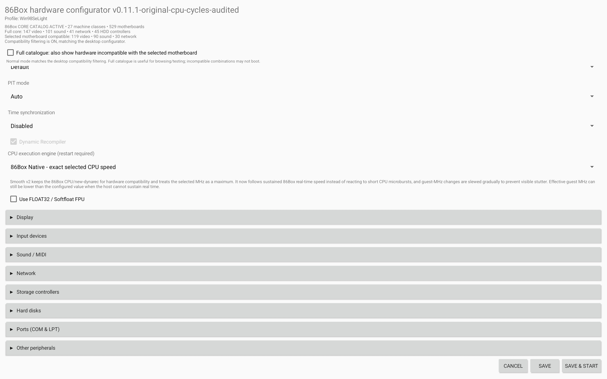
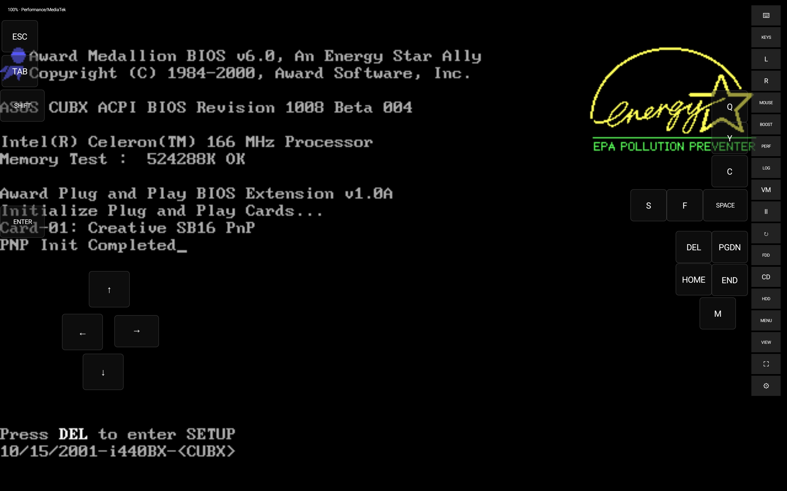
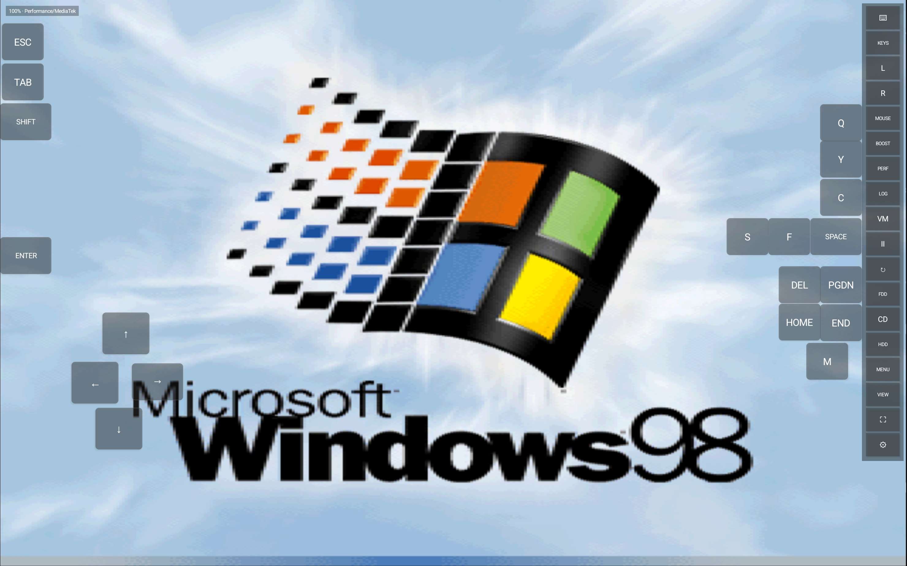
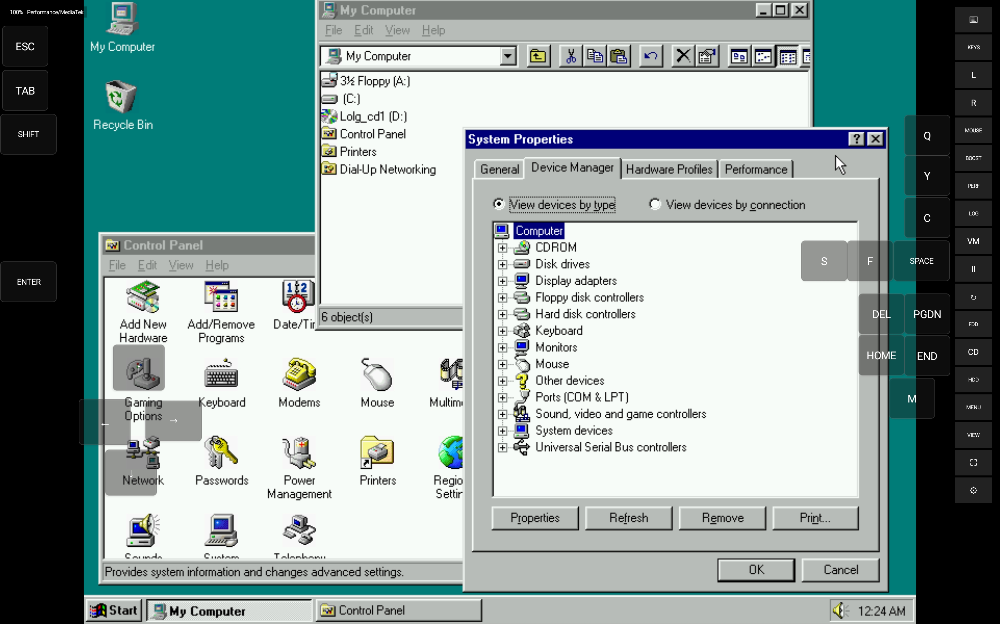
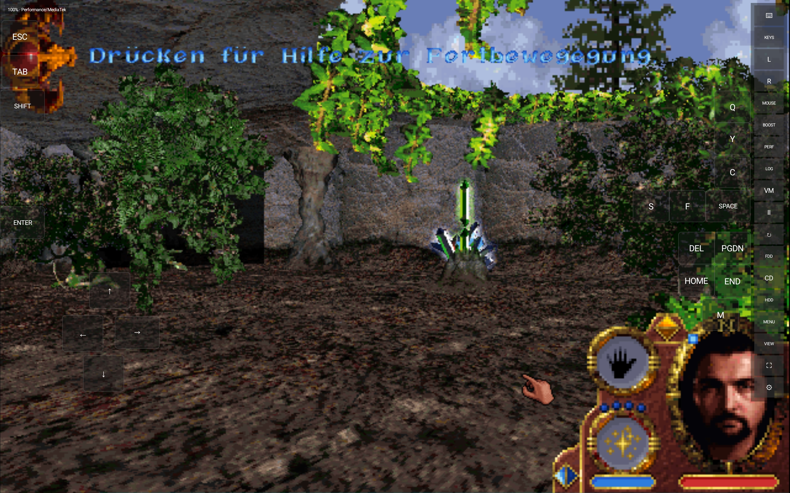
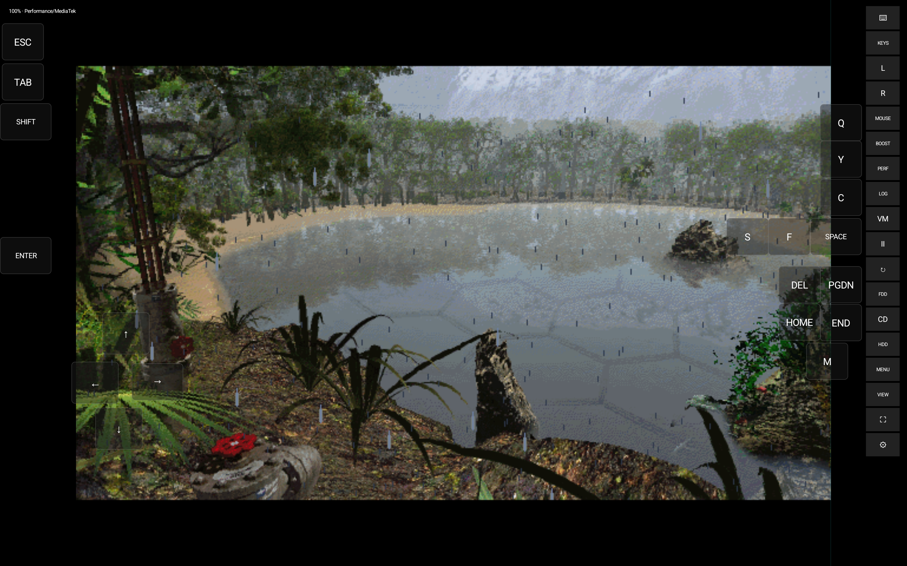
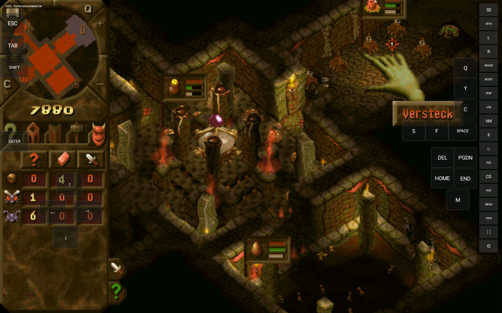
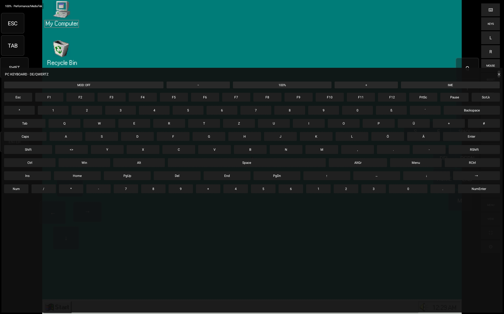
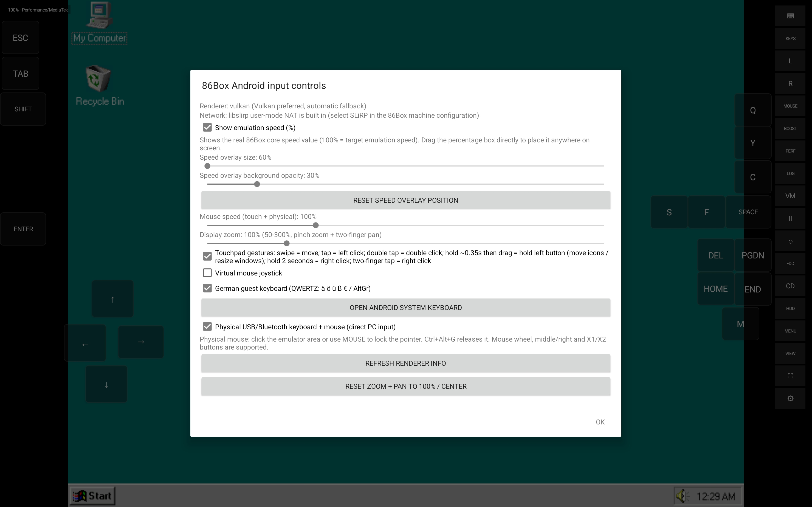

# Screenshots

These screenshots were supplied by the project maintainer and captured on a **Samsung Galaxy Tab S11 Ultra**. They show the Android app and example guest software. Guest operating systems and games are not included with the app.

| View | Image |
| --- | --- |
| Emulated desktop with touch controls |  |
| Hardware profile manager |  |
| Machine and processor configuration |  |
| More hardware and CPU options |  |
| Guest BIOS startup |  |
| Guest operating system startup |  |
| Guest desktop and device manager |  |
| Example game with touch controls |  |
| Example game scene |  |
| Example game with key overlay |  |
| On-screen PC keyboard |  |
| Customizable game key overlay |  |
| Input and display controls |  |

# Deutsch

Diese vom Projektbetreiber bereitgestellten Screenshots wurden auf einem **Samsung Galaxy Tab S11 Ultra** aufgenommen. Sie zeigen die Android-App und beispielhaft ausgeführte Gastsoftware. Die abgebildeten Gastbetriebssysteme und Spiele sind nicht in der App enthalten.

| Ansicht | Bild |
| --- | --- |
| Emulierter Desktop mit Touch-Steuerung | [Bild 1](docs/screenshots/01-win98-desktop.jpg) |
| Verwaltung der Hardwareprofile | [Bild 2](docs/screenshots/02-hardware-profiles.jpg) |
| Rechner- und Prozessorkonfiguration | [Bild 3](docs/screenshots/03-hardware-configurator.jpg) |
| Weitere Hardware- und CPU-Optionen | [Bild 4](docs/screenshots/04-hardware-options.jpg) |
| BIOS-Start des Gastsystems | [Bild 5](docs/screenshots/05-bios-boot.jpg) |
| Start des Gastbetriebssystems | [Bild 6](docs/screenshots/06-win98-startup.jpg) |
| Gast-Desktop und Geräte-Manager | [Bild 7](docs/screenshots/07-win98-device-manager.jpg) |
| Spielbeispiel mit Touch-Steuerung | [Bild 8](docs/screenshots/08-gameplay-outdoors.jpg) |
| Weitere Spielszene | [Bild 9](docs/screenshots/09-gameplay-lake.jpg) |
| Spielbeispiel mit Tastenoverlay | [Bild 10](docs/screenshots/10-gameplay-dungeon.jpg) |
| Bildschirmtastatur für PC-Eingaben | [Bild 11](docs/screenshots/11-virtual-keyboard.jpg) |
| Anpassbares Spieltasten-Overlay | [Bild 12](docs/screenshots/12-game-key-overlay.jpg) |
| Eingabe- und Anzeigeeinstellungen | [Bild 13](docs/screenshots/13-input-controls.jpg) |
